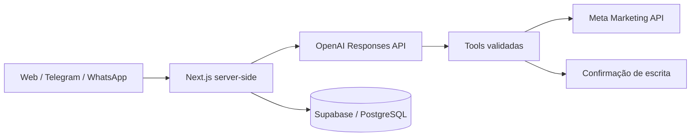

# Atlas Ads AI — Estudo de caso

SaaS multitenant criado para permitir que gestores de tráfego analisem e operem contas Meta Ads usando linguagem natural, pelo painel web, Telegram ou WhatsApp.

## O problema

Operações de mídia paga exigem alternância entre painéis, planilhas e mensageiros. Além do tempo gasto, uma automação sem controles pode alterar campanhas erradas ou executar ações sem autorização.

## A solução

- Leitura e comparação de campanhas, conjuntos e anúncios por linguagem natural.
- Diagnóstico de desempenho com contexto da conta selecionada.
- Integração com Telegram e WhatsApp para consultas operacionais.
- Plano de ação explícito e confirmação antes de qualquer escrita na Meta.
- Histórico auditável e isolamento por workspace.
- Assinaturas, planos e controle de acesso ao produto.

## Arquitetura

## Segurança aplicada

- RLS e autorização por função no servidor.
- Tokens criptografados e nunca enviados ao navegador.
- Validação de entrada e IDs resolvidos no backend.
- Confirmação idempotente para alterações em campanhas.
- Webhooks autenticados e dados separados por empresa.

## Stack

Next.js, React, TypeScript, Supabase, PostgreSQL, OpenAI Responses API, Meta Marketing API, Zod, Docker e Caddy.

## Minha participação

Arquitetura do produto, interface, integrações, fluxos de IA, segurança, testes automatizados, implantação em VPS e validação operacional.

> Este repositório é uma apresentação pública. O código de produção e as credenciais permanecem privados.
